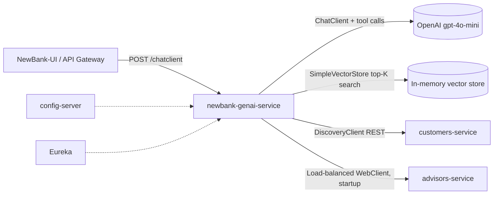

```markdown
# NewBank-genai-service

Conversational banking assistant for the NewBank microservices platform.
It wraps Spring AI's `ChatClient` in a single HTTP endpoint, gives the model **tool access**
to the customer service (list/add customers, open accounts) and a **vector store of advisors**
for retrieval-based advisory matching.

## Overview

| | |
|---|---|
| Runtime | Java 17+, Spring Boot |
| AI stack | Spring AI `2.0.0-M1` — OpenAI starter (`gpt-4o-mini`, temp `0.7`) |
| Web | Spring WebFlux (`web-application-type: reactive`), `WebClient` + `RestClient` |
| Platform | Eureka discovery, Spring Cloud Config, Actuator/Prometheus, Resilience4j |
| Port | `8081` (docker image), overridable via config server |
| Entry point | `com.newbank.microservices.genai.GenAIServiceApplication` |

## Architecture



### Components

| Class | Responsibility |
|---|---|
| `GenAIServiceApplication` | Boot entry point, `@EnableDiscoveryClient` |
| `NewBankChatClient` | `@RestController` exposing `POST /chatclient`; builds the `ChatClient` with system prompt, chat memory, `SimpleLoggerAdvisor`, and `BankTools` |
| `BankTools` | Four `@Tool` methods the LLM may invoke (see [AI tools](#ai-tools)) |
| `AIDataProvider` | Downstream calls to `customers-service`; advisor similarity search over the vector store |
| `AIBeanConfiguration` | `SimpleVectorStore` + `@LoadBalanced WebClient.Builder` beans |
| `VectorStoreController` | Loads `vectorstore.json` from classpath at startup, or builds it from `advisors-service` |
| `dto/*` | Records for customers, accounts, transactions, advisors, expertise |

## API

### `POST /chatclient`

Free-form chat with the banking assistant. Tools are selected by the model from the user message.

```bash
curl -X POST http://localhost:8081/chatclient \
  -H 'Content-Type: text/plain' \
  -d 'List the customers we have in the bank'
```

| | |
|---|---|
| Request body | Raw string (the user prompt) |
| Response `200` | `text/plain` — the assistant's answer |
| Response on failure | `200` with body `Chat is currently unavailable. Please try again later.` (errors are swallowed and logged) |

There is currently no conversation identifier, streaming, or JSON envelope — see improvements.

### AI tools

Exposed to the model via `defaultTools(BankTools)`:

| Tool | Description | Downstream call |
|---|---|---|
| `listCustomers()` | List bank customers | `GET {customers-service}/customers` |
| `addCustomerToBank(CustomerRequest)` | Onboard a customer (first/last name, address, city, phone) | `POST {customers-service}/customers` |
| `listAdvisors(Advisor)` | Find advisors by similarity to criteria | vector store `similaritySearch` (top-K 20, or 50 when no criteria) |
| `addAccountToCustomer(customerId, AccountRequest)` | Open an account (`typeId`: 1 checking, 2 savings, 3 credit, 4 investment, 5 loan) | `POST {customers-service}/customers/{id}/accounts` |

### RAG / advisor search

On startup `VectorStoreController` tries `classpath:vectorstore.json`; if absent it fetches
`http://advisors-service/advisors`, converts to JSON, indexes it in `SimpleVectorStore`, and writes a
dump to a temp file. `AIDataProvider.getAdvisors` serialises the request record to JSON and returns the
top-matching document contents.

## Configuration

| Variable | Purpose | Default |
|---|---|---|
| `CONFIG_SERVER_URL` | Spring Cloud Config server | `http://localhost:8888/` |
| `OPENAI_API_KEY` | OpenAI key for the active starter | `demo` |
| `AZURE_OPENAI_KEY` / `AZURE_OPENAI_ENDPOINT` | Present in `application.yml`, but the Azure starter is **not** on the classpath | — |

Profiles: `production` is active by default; `docker` overrides the config import to
`http://config-server:8888`. Model defaults: `gpt-4o-mini`, temperature `0.7`;
`org.springframework.ai.chat.client.advisor` logs at `DEBUG`.

## Running locally

```bash
# 1. Platform dependencies must be up first:
#    config-server, discovery/Eureka, customers-service, advisors-service
export CONFIG_SERVER_URL=http://localhost:8888/
export OPENAI_API_KEY=sk-...

# 2. Run
mvn spring-boot:run
# -> http://localhost:8081/chatclient, actuator at /actuator

# 3. Docker profile
mvn spring-boot:run -Dspring-boot.run.profiles=docker
```


## Next steps checklist

- [ ] Secure and scope `/chatclient` (auth, conversation id, rate limit)
- [ ] Delete the PetClinic package and detach from the PetClinic parent
- [ ] Rename downstream targets to NewBank services; add timeouts + circuit breaker
- [ ] Remove committed `vectorstore.json`, index at runtime
- [ ] Add tests, CI, wrapper, Dockerfile, OpenAPI, `.env.example`
```

Two notes from inspecting the code rather than the README: the `/chatclient` failure path returns HTTP 200 with an error string, and `vectorstore.json` really does contain PetClinic `radiology` advisor data — both are called out above because they're the most likely to surprise a reviewer.

Want me to commit this into `README.md` through the GitHub web editor (I'd need you to be signed in and confirm the commit), or adjust the tone/length first?
